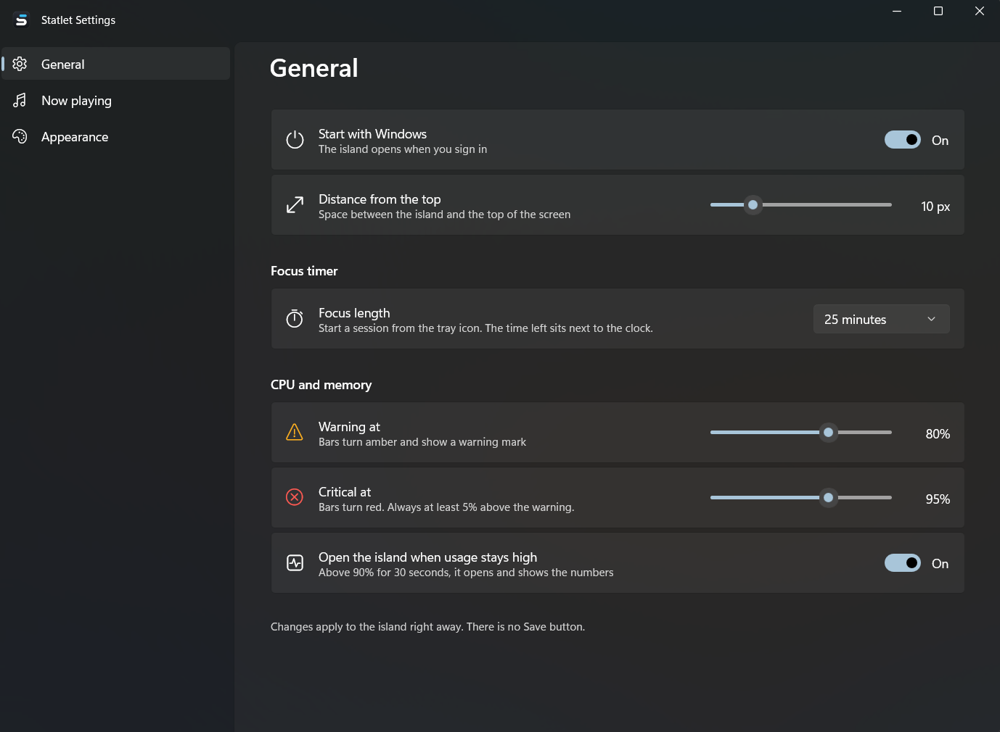

<p align="center">
  
</p>

<h1 align="center">Statlet</h1>

<p align="center">A Dynamic Island for Windows 11.</p>

<p align="center">
  
  
  
</p>

<p align="center">
  
</p>

The top of your screen is mostly wasted. Statlet puts a small dark pill there that shows the day, the time and how hard
your PC is working. That's all it does, until something actually happens. Then it opens, shows you, and gets out of the way.

You don't manage it. You don't close it. It just keeps you in the loop.

**[Download the latest release](../../releases/latest)** · free, open source, Windows 11

## Your music, without the alt-tab

Play something. Spotify, Apple Music, a YouTube tab, pretty much anything that shows up in the Windows media flyout. The
song peeks in with its cover and title, then settles beside the clock with a little equalizer so you know it's there.

Hover over it and you get the whole card: a wavy progress bar that moves with the music, time left, and play, pause and
skip. The bar can even take on the colour of the album art. It's a small thing, but once you have it you'll miss it everywhere else.

## It speaks up only when it matters

<p align="center">
  
</p>

Turn the volume up and the island shows you exactly where it landed, and on which speakers. Battery getting low, the internet
dropping out, a Focus timer starting. Each one gets a card for a few seconds, and then it folds back into the pill by itself.

If your CPU or RAM stays pinned for half a minute, it opens on its own too. Usually that's the first sign something's wrong.

## The small stuff, kept small

<p align="center">
  
</p>

Some things don't need a whole card. A download in progress gets a tiny arrow that breathes until it's done, then a
check. A Bluetooth device connecting, a screenshot you just took: one icon, a couple of seconds, gone.

## Light, and it stays on your PC

Statlet is native C++ talking straight to Windows. It isn't a website wrapped in an app. It wakes up when something
changes and otherwise sits still, and it stops checking anything at all while your screen is off or locked.

It also never goes online. No account, no tracking, no update checks. Your settings and a small log live in one folder
on your PC, and that's the whole footprint. **Nothing is sent anywhere.**

## Make it yours

<p align="center">
  
</p>

The settings app (tray icon > Settings) lets you shape the look: glass, shape, text, bar style, how far down it sits,
what shows while music plays. A live preview updates as you go, so there's no guessing.

## Install

1. Download `Statlet-Setup-<version>.exe` from [Releases](../../releases).
2. Run it. Windows will say "Windows protected your PC" because the setup isn't signed yet: **More info > Run anyway**.
   It installs just for you, with no admin prompt.
3. Open Statlet from the Start menu. To quit: tray icon > **Quit Statlet**.

That's it. No .NET, Visual C++ or Windows App SDK to install first. To update, run a newer setup over the old one and your
settings stay. Want it to start with Windows? Tick the box in the installer or in Settings > General.

<details>
<summary>Check the download, uninstall, and where files go</summary>

- **Check the file:** each release lists the setup's SHA256. In PowerShell, `Get-FileHash .\Statlet-Setup-<version>.exe`
  should print the same value.
- **Where it lives:** the app goes in `%LOCALAPPDATA%\Programs\Statlet`. Settings and the log (`island.log`, app events only)
  go in `%LOCALAPPDATA%\Statlet`. Start with Windows adds one value under `HKCU\Software\Microsoft\Windows\CurrentVersion\Run`,
  and turning it off removes it.
- **Uninstall:** Settings > Apps > Installed apps > Statlet > Uninstall. This also deletes `%LOCALAPPDATA%\Statlet`.
- **Updates:** since Statlet never goes online, it can't tell you about new versions. On GitHub, choose
  **Watch > Custom > Releases** to hear about them. Settings > About has a button that opens the releases page.

</details>

## Good to know

- Windows 11, 64-bit (Intel/AMD). Not tested on Windows 10 or ARM.
- The installer is unsigned for now, so SmartScreen warns once.
- Screenshots come from the tray menu only. Snipping Tool and Print Screen aren't picked up yet.
- Downloads are seen in the root of your Downloads folder only.
- Built and tested on one laptop with one external monitor, so other multi-monitor setups might act up. If yours does, tell me.

## Feedback

Something looks off, or the island vanished? Open an [issue](../../issues) with what you saw, your Windows version and your
monitor setup. Attaching `%LOCALAPPDATA%\Statlet\island.log` helps a lot.

## Build from source

Needs Visual Studio with the C++ x64 tools, the .NET 10 SDK and, for the installer, Inno Setup 7.

```
.\build.ps1        build and test the island (native C++) and the settings app (WinUI 3)
.\package.ps1      build the installer and its SHA256 into dist\
```

See `island/README.md` for how the island works and `docs/adr/` for design decisions. The animations in this README are
drawn by `tools/readme-art/make_readme_art.py` from the app's own sizes and colours.

## License

MIT, see `LICENSE`. The bundled Manrope font is under the SIL Open Font License (`island/assets/OFL.txt`).
