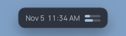
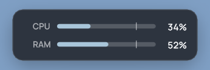
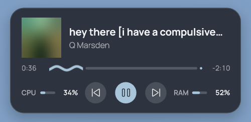
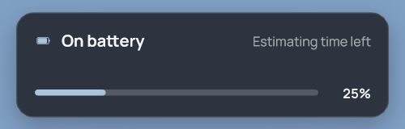
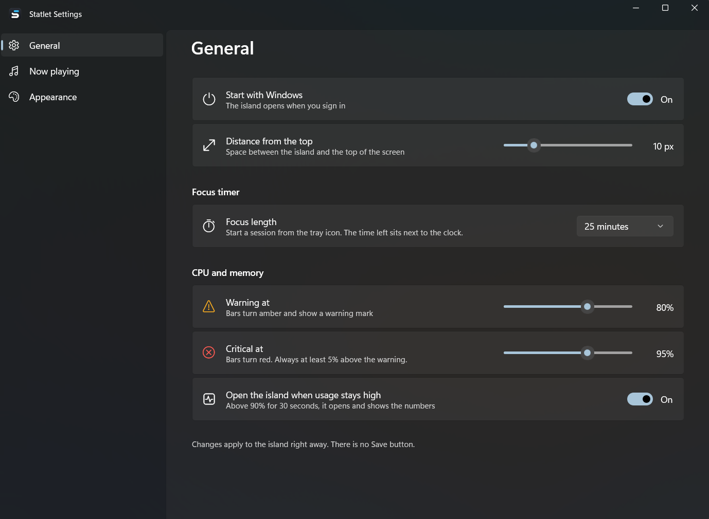

<p align="center">
  
</p>

<h1 align="center">Statlet <sub>(working name)</sub></h1>

<p align="center">
  
  
  
</p>

<p align="center">
  
</p>

A small floating "island" at the top-center of your Windows 11 screen, in the style of the iPhone's Dynamic Island.
It sits quietly as a thin status pill, then opens for the things you care about: volume, battery, network, a Focus
timer and the music that's playing. It is built to cost almost nothing while idle: it wakes only when something changes.

**Status: v1.0.0.** Statlet is a working name and may change.

## What it does

**Always visible: the rest line.** Date and time, plus two mini bars for CPU (top) and RAM (bottom). Bars turn amber at
80% and red at 95%. The pill resizes to fit what it shows.

**Hover to open.** Hovering opens a larger view with labeled CPU and RAM rows. If CPU or RAM stays above 90% for 30
seconds, the island opens by itself so you notice.

**Takeovers.** Short cards that open and then tuck away on their own:
- volume changes (with the output device),
- battery low, critical, charging, unplugged,
- connection lost and back,
- Focus timer (25 min by default; start and stop it from the tray menu).

**Now playing.** Reads Windows' media sessions, so it works with Spotify, Apple Music, browsers and any player in the
Windows media flyout. A new track peeks with album art, title and artist. Hover for the media card: progress bar,
elapsed and remaining time, previous / play-pause / next.

**Settings app.** Tray icon > Settings. Choose how the island looks (glass tint and strength, accent color, shape and
text), how far it sits from the top, the Focus length, the CPU/RAM warning levels, what the rest line shows while music
plays, and whether Statlet starts with Windows. A live preview shows changes as you make them.

**Behaves with your setup.** Follows display scaling and monitor changes, stays out of the way of full-screen apps,
and pauses its polling while the screen is off or the PC is locked or asleep.

## Screenshots

The rest line, always visible: date, time, and CPU / RAM mini bars.



Hover to open it: labeled CPU and RAM rows, with a notch at the 80% warning level.



Hover while music plays for the media card: art (blurred here), title, artist, progress, controls and CPU / RAM.



Takeovers, like this battery card, open on their own and tuck away:



When CPU or RAM runs high, the bars turn red and the island opens on its own:


The settings app (tray icon > Settings), where changes apply to the island right away:



## Install, run, quit

1. Download `Statlet-Setup-<version>.exe` from [Releases](../../releases).
2. Optional check: its SHA256 is listed with the release. In PowerShell, `Get-FileHash .\Statlet-Setup-<version>.exe`
   should print the same value.
3. Run it. Windows will say "Windows protected your PC" because the setup is unsigned: **More info > Run anyway**.
   It installs just for you (no administrator needed) into `%LOCALAPPDATA%\Programs\Statlet`.
4. Start Statlet from the Start menu. Quit: tray icon > **Quit Statlet**.

Nothing else to install: no .NET, Visual C++ or Windows App SDK runtime is needed. Run a newer setup over the old one to update;
your settings are kept.

**Start with Windows** is off by default. Tick it on the installer page, or in Settings > General. The first time you close
Settings with it off, Statlet asks once whether to turn it on.

**Uninstall:** Settings > Apps > Installed apps > Statlet > Uninstall. This also deletes `%LOCALAPPDATA%\Statlet` (your
settings and the log).

## Updates

Statlet never connects to the internet, so it cannot tell you about a new version. To hear about releases, open the
repository on GitHub and choose **Watch > Custom > Releases**, or follow the releases feed. Settings > About has a
**Releases page** button that opens this page in your browser.

## Requirements and known limits

- Windows 11, 64-bit (Intel/AMD). Not tested on Windows 10 or ARM.
- Unsigned, so SmartScreen warns. No auto-update (see Updates).
- Autostart is opt-in (Settings > General > Start with Windows). It adds one value under
  `HKCU\Software\Microsoft\Windows\CurrentVersion\Run`; turning it off removes it.
- Tested on one laptop with one external monitor, so other multi-monitor setups may misbehave.
- Statlet only writes to `%LOCALAPPDATA%\Statlet`: your settings and a small event log (`island.log`, app events only).
  Nothing is sent anywhere.

## Feedback

Open an issue on the [Issues](../../issues) page: what you saw, what you did, your Windows version and monitor setup.
Attach `%LOCALAPPDATA%\Statlet\island.log` if the island vanished or behaved oddly.

## Build from source

Needs Visual Studio with the C++ x64 tools, the .NET 10 SDK and, for the installer, Inno Setup 7.

```
.\build.ps1        build and test the island (native C++) and the settings app (WinUI 3)
.\package.ps1      build the installer and its SHA256 into dist\
```

See `island/README.md` for how the island works and `docs/adr/` for design decisions.

## License

MIT, see `LICENSE`. The bundled Manrope font is under the SIL Open Font License (`island/assets/OFL.txt`).
